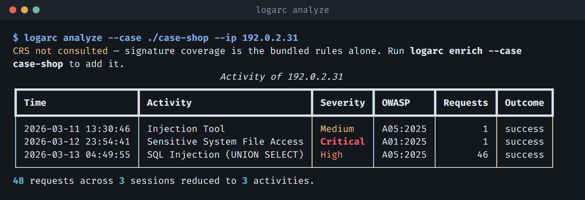
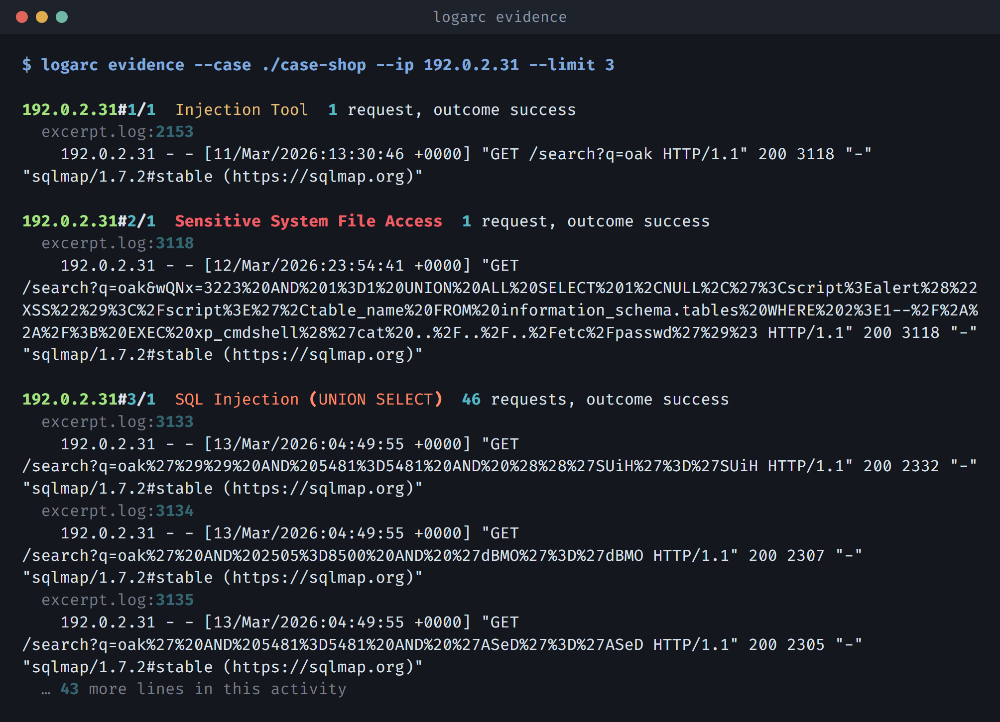
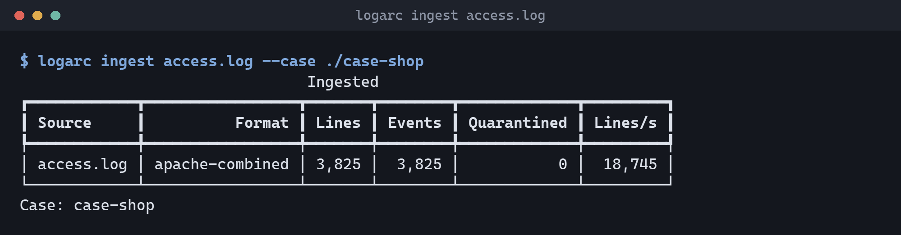
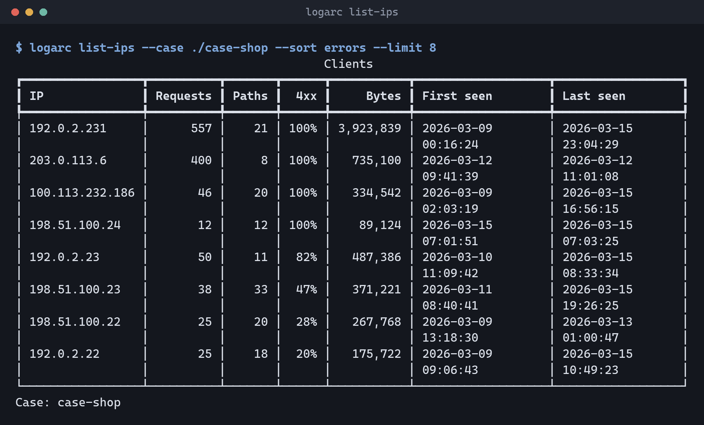

# logarc

**Reconstruct what one IP address actually did on a web server, from its access logs.**

[](https://github.com/FRTX045/logarc/actions/workflows/ci.yml)
[](https://www.python.org/downloads/)
[](LICENSE)
[](#no-network-no-account-no-api-key)

An access log is a flat list of requests. Reading one visitor's story out of it
means reading thousands of lines by hand — slow, easy to get wrong, and not
reproducible by the next person. logarc turns that list into a small number of
**activity episodes** and connects them into a graph:

```
browsing → reconnaissance → directory enumeration → SQL injection → data access
```

Every box links back to the exact raw log lines that produced it.


<sub>sqlmap against a shop. The selected activity is 19 requests of `UNION ALL SELECT`, and the outcome is **success** — the server answered 200. The panel on the right is the evidence: line numbers, statuses, and the raw line exactly as Apache wrote it.</sub>

---

## Try it in two minutes

A real Apache log ships with the repository — 3,825 lines a real server wrote
while real attack tools were pointed at it — so this works in a fresh clone with
nothing downloaded.

```bash
git clone https://github.com/FRTX045/logarc.git
cd logarc
python -m venv .venv
.venv\Scripts\activate            # Windows
source .venv/bin/activate         # Linux and macOS
pip install -e ".[gui]"

# 1. Read the log into a case. The format is detected; nothing is configured.
logarc ingest tests/data/apache-shopfront/excerpt.log --case ./case-shop

# 2. Who looks like they were probing? Sort by the share of 4xx responses.
logarc list-ips --case ./case-shop --sort errors --limit 8

# 3. Reconstruct one of them.
logarc analyze --case ./case-shop --ip 192.0.2.31

# 4. Read the log lines that finding rests on.
logarc evidence --case ./case-shop --ip 192.0.2.31 --limit 3

# 5. A standalone HTML report, or the desktop application.
logarc export --case ./case-shop --ip 192.0.2.31 --format html --out report.html
logarc-gui
```

Step 3 prints this:



Forty-eight requests, three sessions, eight activities — and the two that matter
are named, dated, mapped to OWASP, and marked `success` rather than `blocked`.

Step 4 shows why you can believe it:



---

## What it does

| | |
|---|---|
| **Reads** | Apache, nginx, IIS W3C, Caddy, Traefik, Cloudflare, Google Cloud, ECS, CloudFront — fourteen formats built in, plus any format you write yourself |
| **Finds** | OWASP Top 10 categories that are observable in an access log, plus the ordinary traffic between them |
| **Produces** | An activity graph per client, an HTML or JSON report, and a line-level evidence trail |
| **Runs** | Offline. Evidence never leaves the machine. |
| **Costs** | Nothing. MIT licensed. |

### No network, no account, no API key

logarc makes no outbound connections. Its runtime dependencies are pyarrow,
duckdb, pyyaml, pydantic, typer and rich — no cloud SDK, no model, no telemetry.
The OWASP CRS step, on by default, runs a local Go binary against a local copy
of the ruleset; it is not a service.

This matters because the input is a production access log, which is evidence.

---

## What it detects

Eight hostile categories and five kinds of ordinary use, because **a graph of
attacks alone loses the thread between them** — it cannot tell a scanner that
only probed from an attacker who probed, succeeded, and then used what they had
opened.

| Ordinary use | Attack behaviour |
|---|---|
| `browsing` · `static_asset` · `api_call` · `authentication` · `crawling` | `reconnaissance` · `enumeration` · `injection` · `path_traversal` · `access_control` · `credential_attack` · `ssrf` · `exploitation` |

Two rule families do the labelling. **Signature** rules test one request against
a pattern. **Window** rules test a run of requests against aggregate thresholds,
catching what no single request reveals — twenty 404s in a minute across fifteen
distinct paths is enumeration, while any one of them is a missing page.

Matching runs against **normalised** text, because signatures match text and
attackers know it: `%2553ELECT`, `UNI/**/ON`, fullwidth `ＳＥＬＥＣＴ` and
`SeLeCt` are one request to the server and four strings to a naive rule. Decoding
is bounded to three iterations and the depth is kept, because ordinary traffic is
encoded once and anything beyond that is a deliberate act.

Adding a detection needs no Python — the rules are YAML. See
[docs/writing-rules.md](docs/writing-rules.md).

### About OWASP Top 10 coverage

Bundled rules use [OWASP Top 10:2025](https://top10.owasp.org/2025/).
OWASP classifies vulnerability risks; logarc classifies behaviour visible in
access logs and attaches an optional OWASP annotation. These six categories
are represented, but representation does not mean complete detection coverage:

| OWASP Top 10:2025 annotation | What the bundled rules can indicate |
|---|---|
| A01:2025 Broken Access Control | Access refusals, traversal, forced browsing and SSRF-shaped parameters. These do not prove a successful access-control bypass. |
| A02:2025 Security Misconfiguration | Requests for exposed configuration files, debug endpoints and project metadata. |
| A03:2025 Software Supply Chain Failures | Component paths, dependency manifests, Log4Shell and Shellshock payloads. These four rules concern component risk, not the wider build, distribution or dependency supply chain. |
| A05:2025 Injection | SQL, script, command, template and PHP payload patterns. |
| A07:2025 Authentication Failures | Repeated failed authentication requests and session-fixation indicators where the required fields are logged. |
| A08:2025 Software or Data Integrity Failures | PHP serialised-object payloads that suggest object injection, not proof of unsafe deserialisation. |

No bundled annotations claim A04 Cryptographic Failures, A06 Insecure Design,
A09 Security Logging and Alerting Failures, or A10 Mishandling of Exceptional
Conditions. Repeated server errors alone do not establish A10.

Internal activity categories, including `ssrf`, remain independent of OWASP
numbers. Custom rules may retain older edition-qualified annotations such as
`A03:2021`; findings and exports preserve those values.

---

## The desktop application

```bash
logarc-gui
```


<sub>The **behaviour map**: the same reconstruction folded by activity type, so repetition becomes structure. 201 episodes become five nodes, and `x23` on an arrow says the client went round that loop twenty-three times — the thing a chronological trace cannot show. The evidence panel holds all 242 requests of the selected one: `/admin.php`, `/vendor/`, `/db.sql`, `/backup.zip`, `/phpmyadmin/` — a wordlist, being worked through.</sub>

Pick a client, read the graph, click a node to see the lines behind it, narrow
the case to a stretch of time, export the same report the CLI produces.

Opening a case also starts **Where to start**, with **Suspicious activity**
and **Unusual activity** queues. Each recommendation explains its measurements
and links to source evidence. The client list pages through every client in the
case, busiest first, and its filter searches the whole case, including clients
outside the busiest 500, while scanning, after cancellation or after a scan
failure. See [IP prioritization](docs/ip-prioritization.md)
for ranking policy, limitations and measured evaluation results.

**Full guide, with every screen: [docs/desktop-app.md](docs/desktop-app.md).**

The window also exports the canvas as a **PNG** and reconstructs a selected
**stretch of time**. Reconstruction shares the same `logarc.case` and
`logarc.analysis` functions with the command line. Prioritization is available
in the GUI and reuses the reconstruction engine's session and labeling rules.

---

## Log formats


The format is detected from the first lines of a log. When it cannot be, ingest
**refuses rather than guessing** — the wrong parser quarantines every line and
presents as an empty result, which is the worst failure this tool has.

```bash
logarc formats                     # every format, built in and saved
```


A format you write yourself is a first-class one: saved by name, offered wherever
the built-ins are, usable in every later case. There are four kinds, and none of
them needs Python.

```bash
# A text log: write the Apache LogFormat directive down.
logarc formats check '%h|%t|"%r"|%>s|%b' --log access.log
logarc formats add office-edge '%h|%t|"%r"|%>s|%b'

# One JSON object per line: the mapping is proposed for you, nested keys included.
logarc formats check-json --log gateway.jsonl
logarc formats add-json gateway --log gateway.jsonl --map client_ip=http_x_real_ip

# A table: IIS declares its columns in `#Fields:`, most CSVs in the first row.
logarc formats add-columns iis --log u_ex240501.log
logarc formats add-columns edge --log edge.csv --separator comma

# Anything else — syslog-wrapped, an appliance with a syntax of its own.
logarc formats add-pattern gw-proxy '^(?P<timestamp>\S+) (?P<client_ip>\S+) …' \
    --time-format '%Y %b %d %H:%M:%S'
```

A time format naming no year is **refused** rather than accepted: `strptime`
supplies 1900 for a missing year, and a case where every event is dated 1900 is
exactly the kind of number this tool exists not to emit.

**A format is a definition, not a name.** Each case records the definition it was
ingested with, so editing or deleting a saved format later cannot make an
existing case unreadable. See
[ADR-0010](docs/adr/0010-a-log-format-is-data-that-travels-with-the-work.md).

Deliberately absent: AWS ALB, Envoy and HAProxy, which write the client as
`address:port`. Stripping the port is not safe without deciding what to do about
IPv6, where the colons are part of the address, and a wrong answer turns every
connection from one client into a client of its own. All three are readable today
with a pattern of your own.

---

## How well does it work

Measured on a real Apache log whose contents are known: the
[BlackHat-Dataset](https://github.com/FRTX045/BlackHat-Dataset) `apache-shopfront`
`2026-10-06-medium` build — 235,732 requests over seven days, a real PHP shop
driven by real security tools, where a tagging proxy joins every line to a record
of which client made the request and why. It includes an administrator doing
ordinary work, which matters more than it sounds: see the false-alarm figure.

Measured 2026-10-09 on a build made at a named commit from a clean tree, whose
checksums were verified before scoring. Native rules only; CRS, which runs
after every scan by default, is the paragraph below the table.

| | |
|---:|---|
| **0.997** | accuracy over 235,732 requests |
| **0.997** | weighted F1 |
| **0.953** | macro F1 — *see below* |
| **1.000 / 0.998** | attack precision / recall |
| **0 requests** | false alarms, in 235,732 |
| **85,908** | lines per second ingesting, with the default four workers |
| **0** | lines quarantined, and 0 truth lines unmatched |

**Both numbers, or neither.** No false alarm in 235,732 requests is one axis and
not a claim that the rules are nearly right. Macro F1 of 0.953 is the other, and
it is an unweighted mean over fourteen categories, so a category with five
requests counts as much as one with 162,801. The weakest are the smallest:
`ssrf` names 4 of 5, `exploitation` 6 of 8 and `unknown` 124 of 201. The
tool's commonest mistake is calling an attack by a neighbouring name, 440 times
`enumeration` read as `reconnaissance`, which costs nothing on the first axis and
something on the second. Both are printed so neither can hide the other.

**With OWASP CRS at paranoia level 2**, the same build scores accuracy 0.997,
macro F1 0.952 and **0 false alarms**, and catches one attack the native rules
miss: 17,108 against 17,107. Across the three `2026-10-06` builds CRS adds 1 to
3 catches per build and no false alarm; until 2026-10-14 it added one on the
small build, a Google Ads click ID read as SQL. Until 2026-10-06 CRS also called
the shop's own unfilled `?id=${id}` placeholder an injection, 149 times on this
build;
[the rule-pack ledger](docs/rule-pack-ledger.md) has how that was found and
what changed.

**Macro F1 is lower than the figure this project once published, and that is not
a regression.** Until September 2026 accuracy was measured against a corpus this
project generated itself, which scored macro F1 0.958. Moving to a log written by
a real server dropped it to 0.633, and work on the rules — and on defects the
dataset found in itself — has since brought it to 0.953 on the current build:
against real traffic, not against a corpus built to be scored. That first
drop was the first honest measurement, and
[ADR-0011](docs/adr/0011-a-real-server-log-is-the-headline-corpus.md) records why
the generator was deleted rather than kept.

Per-category figures below about fifty requests of support are an indication, not
a measurement, and [docs/evaluation.md](docs/evaluation.md) names which those are,
along with every caveat these headline numbers carry.

---

## How it refuses to lie to you

The failure this tool is built against is not a crash. It is a case that looks
complete and is not.

- **A log it cannot read is refused, not guessed at.** A wrong parser quarantines
  every line and presents as a clean, empty case.
- **Malformed lines are quarantined and counted, never dropped.** A case that
  could not read all of its logs says so every time it is opened.
- **A cancelled ingest leaves the case un-finalised**, so a partial read cannot be
  analysed as if it were whole.
- **An analysis that ran without CRS says so on every run**, rather than quietly
  reporting less.
- **A time format with no year is refused**, rather than dating every event 1900.
- **No progress estimate is shown until the read has settled**, and it always
  reads *about*.
- **`case.json` records every threshold used**, the rule-pack versions and hashes,
  the CRS revision, and a SHA-256 of every source file — so a finding can be
  reproduced from the manifest alone, or shown not to be.

---

## Installing

Requires **Python 3.11 or newer**. The engine and the command line are tested on
Linux and Windows, Python 3.11 and 3.12, on every push.

**The desktop application is built and packaged for Windows, and runs on Linux.**
Its tests run on Linux headless (`QT_QPA_PLATFORM=offscreen`), and on
2026-10-05 it was also run on real display servers: Ubuntu 24.04 under WSLg,
Qt 6.11, once on Wayland and once on X11 (XWayland). Both opened a case, listed
its clients, drew a client's graph, showed the evidence behind an activity and
switched between Where to start, Trace and Behaviour, with no warning from Qt
and a clean exit. What that run did not cover: a full GNOME or KDE session on
real hardware, native file dialogs, and HiDPI scaling. macOS has neither a
runner nor a report.

On X11, Qt needs a few XCB libraries that minimal installs leave out. The
symptom is *"Could not load the Qt platform plugin "xcb""*; on Debian and
Ubuntu the fix is:

```bash
sudo apt install libxcb-cursor0 libxkbcommon-x11-0 libxcb-icccm4 libxcb-image0 \
  libxcb-keysyms1 libxcb-render-util0 libxcb-shape0 libxcb-xkb1 libxcb-util1
```

Wayland needed nothing beyond what the system already had.

```bash
pip install -e ".[gui]"      # the tool and the desktop application
pip install -e "."           # the command line alone
pip install -e ".[dev]"      # add the test and lint toolchain
```

### A packaged Windows build

```bash
pip install -e ".[gui,package]"
python packaging/rebuild.py
```

Produces `dist/logarc/` (~270 MB), which runs without Python installed, and
with CRS enrichment working: the script builds the CRS sidecar and bundles it
with the ruleset and the licences of everything compiled into it, so the build
needs Go and the ruleset clone described under *OWASP CRS* below. One
folder rather than one file: a one-file build unpacks the whole bundle to
`%TEMP%` on every launch, which with Qt and Arrow in it costs seconds each time
and leaves copies of the tool behind.

Use `rebuild.py` rather than `pyinstaller` directly, because **PyInstaller exits
0 on a bundle that is missing what it could not see** — the rule packs are data
that nothing imports, and a build without them reports every request as benign.
The script runs the tests, builds into a staging directory, checks for the things
an exit code cannot, and only then swaps the result into place. One of those
checks sends the bundled sidecar a SQL injection and requires CRS rule 942100
to answer, so a bundle whose CRS starts but cannot find its rules is refused.

The staging checks also load the packaged Qt extensions in an isolated process.
Windows system DLLs take precedence during collection, so unrelated tools on
`PATH` cannot substitute an incompatible ICU library and break GUI startup.

It builds the working tree, so it also refuses a tree that moved while it ran.
A branch switch, a pull or an edit during those minutes would leave the tests,
the sidecar and PyInstaller each reading something different. When that
happens nothing is swapped in, and the status file says what moved. Run it
again once the tree is settled.

### OWASP CRS

The bundled rules classify *behaviour*; OWASP CRS enumerates payload *syntax*,
which is a different job and one it does far better. Both run, and CRS never
overrides a rule that examined the request — it names the ones nothing else
recognised.

**It runs after every scan, without asking.** The window replays each new case
through CRS on a card that can be stopped, keeping what it found so far, and
`logarc ingest` does the same once the log is read. To turn it off:

| Where | How |
|---|---|
| The window | Edit → Preferences → Analysis → *Run OWASP CRS after a scan* |
| One `ingest` | `--no-crs` (and `--crs` asks for it whatever the machine says) |
| A whole machine, both | `LOGARC_CRS=off` |

Turned off or not, *Case → Run OWASP CRS on this case* runs it on the open
case whenever asked, as `logarc enrich` does on the command line.

The packaged Windows build carries the sidecar and the ruleset, so there is
nothing to install. From source, set them up once:

```bash
logarc setup-crs                                # needs git, Go 1.25+ and a connection, once
logarc enrich --case ./case-shop --paranoia 3   # run again, at another level
```

`setup-crs` fetches the ruleset at the revision this project measures against
(`d694d465951ee06347214f1291ae096e40700001`), builds the sidecar, and replays a
known SQL injection to prove the two work together. It is the one time logarc
reaches for the network, and only because it was asked to. The manual steps are
in [crs/README.md](crs/README.md).

Without the sidecar, a scan says once that CRS was not run and carries on: the
case analyses on the bundled rules alone, and says so on every run.

---

## Command line



| Command | What it does |
|---|---|
| `logarc ingest` | Read logs into a case, then replay it through OWASP CRS (`--no-crs` skips that). Streaming; memory is bounded by batch size, not file size. `--workers N` spreads the parse across processes. |
| `logarc list-ips` | List the clients seen. `--sort errors` ranks by the share of 4xx, which is what probing looks like. Also `requests`, `recent`, `bytes`, `paths`. |
| `logarc analyze` | Reconstruct one client's activity as a graph. `--out` writes it as JSON. |
| `logarc evidence` | The raw log lines a finding rests on — the other half of the chain of custody. |
| `logarc export` | A standalone HTML or JSON report for one client. |
| `logarc enrich` | Run OWASP CRS over a case again, or at another paranoia level. |
| `logarc setup-crs` | From a source checkout: fetch the pinned CRS ruleset and build the sidecar, once. |
| `logarc formats` | See, write and try out log formats. |
| `logarc evaluate` | Measure the reconstruction against a log whose content is known. |
| `logarc benchmark` | Throughput, peak memory and reconstruction time, on a log you give it. |
| `logarc convert-csic` | Turn the CSIC 2010 dataset into an access log logarc can read. |



---

## How it works

The research question is: **how do you separate one action from another, and then
classify it** — at log sizes measured in gigabytes, offline?

logarc answers it with deterministic three-level segmentation and a two-pass
ingest architecture. Determinism is a deliberate constraint: a forensic finding
must be explainable and reproducible, so every boundary the tool draws can be
traced to a stated rule and a recorded threshold.

**Two passes.** Ingest is O(n) over the log and happens once per case. Analysis
is O(k) over one client's events and happens many times, interactively. After
ingest, selecting a client reads roughly 1/64 of the store, so everything after
retrieval runs in memory instantly.

**Three levels of segmentation.**

1. **Session** — new session on an idle gap over 30 minutes, a User-Agent change
   (same address, different client: the NAT case), or 8 hours elapsed.
2. **Request label** — signature, window and sequence rules, over normalised text.
3. **Episode** — new episode when the category changes or the gap exceeds 5
   minutes, then one merge pass absorbs short benign interludes between
   same-category episodes. Without that pass a single `favicon.ico` fetch splits
   one attack into three.

Full detail in [docs/architecture.md](docs/architecture.md), and the reasoning
behind each choice in [docs/adr/](docs/adr/).

---

## Development

```bash
ruff check . && ruff format --check .
mypy src/logarc
mypy --platform linux src/logarc    # not redundant — some code is platform-shaped
pytest --cov=logarc --cov-report=term-missing
```

The second type check matters: `mypy` analyses for the platform it runs on, so a
Windows-only branch guarded by `sys.platform` is skipped on Windows and checked
on Linux, and the reverse.

`pytest`'s default temp root is unwritable on some Windows machines; set
`PYTEST_DEBUG_TEMPROOT` to a short writable path if the suite fails to start.

The four CRS contract tests skip without the Go binary. `LOGARC_REQUIRE_CRS=1`
turns that skip into a failure; CI sets it.

### The whole CI, locally

```bash
tools/local-ci.sh              # the commit at HEAD
tools/local-ci.sh my-branch    # or any ref
```

Runs the jobs of `.github/workflows/ci.yml` on your machine: lint and both
type checks in a Linux container, the test suite on Linux in Docker for each
Python version the workflow lists, and on Windows natively when run from Git
Bash. Every test job builds the CRS sidecar, requires it, and holds the 94%
coverage floor. It tests the commit, not your working tree, and gives each run
fresh environments, so it passes or fails as a clean runner would.

It reads the Python versions and the CRS pin from the workflow rather than
repeating them, so the two cannot drift, and `tests/test_local_ci.py` checks
that. Needs Docker, [uv](https://docs.astral.sh/uv/), the ruleset clone above,
and on Windows Git Bash and Go 1.25+. A summary is printed and kept under
`~/.cache/logarc-ci/runs/` (`LOGARC_CI_DIR` moves it). Exit 0 means every job
passed; 3 means nothing failed but some jobs could not run on this machine.

---

## Documentation

| | |
|---|---|
| [docs/architecture.md](docs/architecture.md) | Layers, data flow, extension points |
| [docs/desktop-app.md](docs/desktop-app.md) | The desktop application, screen by screen |
| [docs/writing-rules.md](docs/writing-rules.md) | Adding detection without writing Python |
| [docs/adding-a-parser.md](docs/adding-a-parser.md) | Supporting another log format |
| [docs/evaluation.md](docs/evaluation.md) | How accuracy is measured, the numbers, and their limits |
| [docs/manual-test-plan.md](docs/manual-test-plan.md) | What the automated suite cannot check |
| [docs/adr/](docs/adr/) | Eleven architecture decision records, including the ones that were wrong |
| [CHANGELOG.md](CHANGELOG.md) | What has changed, including what falls short |

---

## Status

Early development, version 0.2.0. The engine and both front ends work and are
tested on every push; interfaces may still change. Outside contributions are not
open yet.

## License

MIT — see [LICENSE](LICENSE). Third-party notices in [NOTICE](NOTICE).
