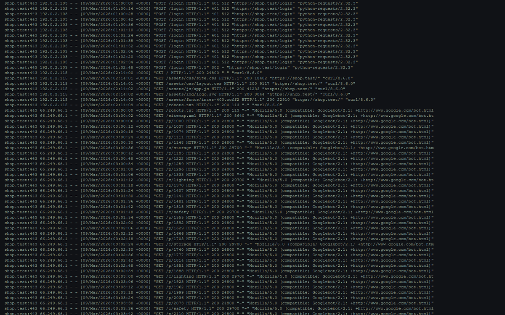
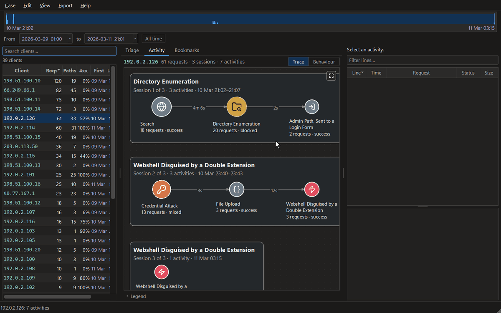

**Reconstruct what one IP address actually did on a web server, from its access logs.**

[](https://github.com/FRTX045/LogarX/actions/workflows/ci.yml)
[](https://www.python.org/downloads/)
[](LICENSE)
[](#no-network-no-account-no-api-key)
[](https://github.com/FRTX045/LogarX/releases/latest)

LogarX is a desktop application that turns a web server's access log into a
readable account of what each client did. Instead of thousands of lines, you get
each client's requests grouped into **activities**, connected in the order they
happened, and every one of them opens the exact log lines it was built from.



<sub>Open a log and LogarX ranks who to look at first. The top client becomes a chain across three visits: a wordlist that finds `/admin`, a password guessed on the thirteenth try, an upload that is really a PHP shell, and a return to use it, with the exact log line behind each step. A second client's sixty back-and-forth requests fold into two activities in the behaviour map. The traffic is synthetic, written for this demo.</sub>

---

## The problem

It is Friday, 11 pm, and an email arrives from your hosting provider:
*suspicious traffic was detected on your site.* Did someone get in? Are your
customers safe? What do you tell them?

You download the access log. It is a million lines of addresses, timestamps and
slashes. The clues are in there, but reading them by hand is slow and easy to get
wrong, writing queries takes skills you may not have, and uploading the log
means handing your visitors' data to someone else just to understand it.

LogarX is built for that moment. You open the log, and instead of a million
lines you get a short list of who to look at first, each with its reason in
plain words. Click one address and its requests become steps you can read: an
ordinary-looking search, then searches no customer would type, then a burst of
requests aimed at your database through the search page, every one answered
with HTTP 200 (OK). Click any step and the exact log lines behind it are there,
with encoded parts made readable and the original line kept. At no point do you
write a query, a command or a regular expression.

You finish with something you can act on: the requests that concern you, the
evidence behind them, and a report to send to your host or your developer. An
OK from the server does not prove an attack worked, but the linked requests give
you something concrete to investigate.

---

## Who it is for

**Accessible to non-specialists; easier to inspect, verify and explain for
professionals.**

| | Non-specialist | Professional |
|---|---|---|
| **Who** | A shop owner, school or campus IT, a freelance web developer | An IT or security analyst, an incident responder, a consultant |
| **Their problem** | "I can't turn this log into something I can explain." | "Extracting, grouping and explaining the requests takes manual work." |
| **What LogarX gives them** | No SQL, regular expressions or terminal for supported formats, and a shortlist with plain-language reasons | The same workflow, plus a record to check: a SHA-256 of every source file, the rule configuration in each report, and every finding traced to its log line |

---

## How it helps

| Step | The question | What LogarX does |
|---|---|---|
| **Open the log** | "What format is this? Do I need a database?" | **Case → New from logs…** detects the format (twenty-one are built in) and reads the log on your machine. Lines it cannot read are counted and reported, never silently dropped. |
| **Find a starting point** | "A million lines. Where do I look?" | **Triage** ranks clients in a *Suspicious* and an *Unusual* queue, each with a *Finding* and the reasons behind its place. |
| **Understand and check** | "What did this address do, in what order, and how did the server answer?" | Each client becomes a graph of activities, grouped into sessions with their times and a name for each, which you can change. A node's outline summarises the response codes it received, and the icon inside it says what kind of activity it was. Click it and the evidence panel lists the requests behind it, decoded, with the raw line kept and repeated lines folded. |
| **Explain and hand over** | "How do I show this to someone who can act?" | **Ctrl+D** bookmarks a client, an activity or a line, with a note. **Export** writes a report (HTML), the graph (JSON), or every bookmark (CSV). |
| **Teach it** | "It missed something I can see." | Right-click the line and choose **Make a rule from this line…**. Choose the parts to match, name and classify the rule, review what it matches, then **Add rule**. **Re-read now** applies it to the open client and restarts Triage. There is no YAML to write yourself. |



<sub>The shell's lines name the file, `invoice.php.jpg`; one step back, its upload through the admin page was read as an ordinary file upload. A rule made from that line, previewed against the case before it is added, and the client read again. The traffic is synthetic, written for this demo.</sub>

---

## Try it

The story above is illustrative. What follows is real: an Apache log ships with
the repository, 3,825 lines a real server wrote while real attack tools were
pointed at it, so no separate dataset download is needed. Only the timestamps
were changed, moved onto a realistic week; the dataset explains how.

```bash
git clone https://github.com/FRTX045/LogarX.git
cd logarx
python -m venv .venv
.venv\Scripts\activate            # Windows
source .venv/bin/activate         # Linux and macOS
pip install -e ".[gui]"
logarx-gui
```

Then, in the window:

1. **Case → New from logs…** (Ctrl+N), choose
   `tests/data/apache-shopfront/excerpt.log`, then an empty folder for the case.
   The format is detected; nothing is configured. On a fresh clone a notice
   then says **CRS is not installed**: the case is complete without it, so
   choose **Continue**. The walkthrough then runs on the native rules alone.
   [docs/installing.md](docs/installing.md#owasp-crs) sets up that optional
   second ruleset, which the packaged Windows build includes.
2. The case opens on **Triage**, which ranks the clients worth reading first
   out of 52, each with its finding and the measurements behind its place.
3. Click **192.0.2.31** in the client list. Its 48 requests, over three
   sessions, become three activities, and the last is 46 requests of SQL
   injection, every one answered with HTTP 200.
4. Click that activity. The evidence panel lists the log lines it rests on, and
   shows each raw line exactly as the log holds it. Type `status:200` in the box
   above it to filter.
5. Type `activity:injection` in the box above the client list to find the
   clients the scan saw injection activity on.
6. **Ctrl+D** bookmarks what you are looking at. **Export → Report (HTML)…**
   writes a standalone report.


<sub>Step 4 on this log: sqlmap against the shop, in the last of three sessions. The selected activity is 46 requests: 30 `UNION ALL SELECT`, 11 always-true conditions, one column count, and four known only by sqlmap's user agent. The server answered every one with HTTP 200. The panel on the right is the evidence: line numbers, statuses, and the raw line exactly as Apache wrote it.</sub>


<sub>The **Behaviour** view of another client, 192.0.2.231: the same reconstruction folded by activity type, so repetition becomes structure. Its 157 activities become two nodes, and `x45` and `x41` on the arrows say it switched from one to the other 45 times and back 41 times, which the chronological trace leaves you to count by hand. The evidence panel holds all 355 requests of the selected one: `/admin.php`, `/vendor/…`, `/db.sql`, `/backup.zip`, `/shell.php`. A wordlist, being worked through.</sub>

Every screen is described in [docs/desktop-app.md](docs/desktop-app.md).

---

## What it does

| | |
|---|---|
| **Reads** | Apache, nginx, Kubernetes ingress-nginx, IIS W3C, Caddy, Traefik, HAProxy, Envoy, Istio, Cloudflare, Google Cloud, AWS ALB, ECS, CloudFront: twenty-one formats built in, plus any format you write yourself |
| **Finds** | Access-log patterns mapped to selected OWASP Top 10 categories, plus the ordinary traffic between them |
| **Produces** | An activity graph per client, an HTML or JSON report, and a line-level evidence trail |
| **Runs** | Offline. Evidence never leaves the machine. |
| **Costs** | Nothing. MIT licensed. |

### No network, no account, no API key

Reading a log, analysing it and reporting on it make no outbound connections.
The one command that reaches the network is `logarx-dev setup-crs`, run once and by
choice in a source checkout to fetch the CRS ruleset and build the sidecar; the
packaged application has nothing to set up. **Help → User guide** opens the
online guide in your browser, which is the browser's request, not LogarX's. Its
runtime dependencies are pyarrow,
duckdb, pyyaml, pydantic, typer and rich, and the desktop application adds
PyQt6: no cloud SDK, no model, no telemetry.
The OWASP CRS step, on by default, runs a local Go binary against a local copy
of the ruleset; it is not a service.

This matters because the input is a production access log, which is evidence.

---

## Built not to mislead

The failure this tool is built against is not a crash. It is a case that looks
complete and is not.

- **A log it cannot read is refused, not guessed at.** If a log produces no
  events, LogarX stops and names the format it was read as, rather than
  presenting a clean, empty case.
- **Malformed lines are quarantined and counted, never dropped.** A case that
  could not read all of its logs says so every time it is opened.
- **A cancelled read leaves the case unfinished**, so a partial read cannot be
  analysed as if it were whole.
- **An analysis that ran without CRS says so on every run**, rather than quietly
  reporting less.
- **A time format with no year is refused**, rather than dating every event 1900.
- **No progress estimate is shown until the read has settled**, and it always
  reads *about*.
- **`case.json` records a SHA-256 of every source file**, the format definition
  each was read with, and, when CRS enrichment has run, its revision and
  settings. Each JSON export records
  the ruleset fingerprint and the session and activity thresholds, so a finding
  names the rules and settings that produced it.

---

## How well does it work

Scored 2026-10-14 as the complete tool, native rules plus OWASP CRS at paranoia
level 2 (revision `d694d465`, configuration `f4a1c8296441d261`), on 235,732
requests from the
[LogarX Dataset](https://github.com/FRTX045/LogarX-Dataset) `apache-shopfront`
build `2026-10-06-medium`: **accuracy 0.9975, macro F1 0.9525 and 0 false alarms**, with 41
attack requests missed. Macro F1 is the lower figure because it weighs every
category equally, and the smallest categories hold only a handful of requests.
The build is published as a
[release of the dataset](https://github.com/FRTX045/LogarX-Dataset/releases/tag/2026-10-06-medium),
and rerun from a fresh download on 2026-10-28 it gave every one of those figures
again. What anyone can rerun without downloading anything is the
committed 3,825-request excerpt, which the test suite scores with CRS
wherever the sidecar and ruleset are built, and CI always does:
accuracy 0.9749, macro F1 0.9592 and 0 false alarms with CRS, 21 attack requests
missed. [docs/evaluation.md](docs/evaluation.md) has the method, the
per-category figures and what the numbers do not establish, and
[docs/limitations.md](docs/limitations.md) what LogarX cannot tell you.

---

## Installing

Requires **Python 3.11 or newer**. The engine is tested on Linux and Windows,
Python 3.11 and 3.12, on every push. The desktop application is built and
packaged for Windows, and runs on Linux.

```bash
pip install -e ".[gui]"      # the tool and the desktop application
pip install -e "."           # the engine and developer tools alone
pip install -e ".[dev]"      # add the test and lint toolchain
```

**On Windows, download the application** from
[Releases](https://github.com/FRTX045/LogarX/releases/latest): unzip it and run
`logarx.exe`. Nothing else is needed, Python included. To build the same thing
from a checkout, run `python packaging/rebuild.py`. Linux display libraries, the packaged build and the
OWASP CRS sidecar are covered in [docs/installing.md](docs/installing.md).

---

## Log formats it reads

Twenty-one formats are recognised on their own, from the first lines of a log.
Nothing has to be configured.

| Server | Formats |
|---|---|
| Apache | `combined`, `common`, `vhost_combined`, `vhost_common`, and `combined` with mod_logio's byte counts |
| nginx | `combined`, the `main` format of nginx.org's packages and Docker image, `combined` with the forwarded-for header and request time, and the widely copied JSON template |
| Kubernetes ingress-nginx | its default, `upstreaminfo` |
| Traefik | the default text log, and JSON |
| Caddy | the default JSON access log |
| HAProxy | `option httplog`, bare or in any syslog envelope |
| Envoy and Istio | their default access logs |
| IIS | W3C extended |
| AWS | Application Load Balancer and CloudFront |
| Cloudflare | Logpush HTTP requests |
| Google Cloud | load balancer request logs |
| Elastic | Elastic Common Schema, as Filebeat and the Elastic Agent write it |

Servers that write Apache's `combined` line, such as OpenLiteSpeed and Express's
morgan, are read as it. Any other log is a format you write once, in
**Case → Formats and rules…**: an Apache `LogFormat` directive, an nginx
`log_format` pasted as it is, a JSON mapping, a table with its columns, or a
regular expression. [docs/log-formats.md](docs/log-formats.md) has the details.

---

## Documentation

| | |
|---|---|
| [docs/installing.md](docs/installing.md) | Installing, the packaged Windows build, and OWASP CRS |
| [docs/desktop-app.md](docs/desktop-app.md) | The desktop application, screen by screen |
| [docs/detection.md](docs/detection.md) | What it detects, and what its OWASP Top 10 annotations do and do not claim |
| [docs/log-formats.md](docs/log-formats.md) | The twenty-one built-in formats, and writing your own |
| [docs/evaluation.md](docs/evaluation.md) | How accuracy is measured, the numbers, and their limits |
| [docs/limitations.md](docs/limitations.md) | What LogarX cannot tell you, and why |
| [docs/architecture.md](docs/architecture.md) | How it separates one action from the next, layers and data flow |
| [docs/writing-rules.md](docs/writing-rules.md) | Adding detection without writing Python |
| [docs/adding-a-parser.md](docs/adding-a-parser.md) | Supporting another log format in code |
| [docs/command-line.md](docs/command-line.md) | The developer command line |
| [docs/adr/](docs/adr/) | The architecture decision records, including the ones that were wrong |
| [CHANGELOG.md](CHANGELOG.md) | What has changed, including what falls short |

---

## License

MIT. See [LICENSE](LICENSE). Third-party notices are in [NOTICE](NOTICE).
