# The desktop application

```bash
logarc-gui
```

Everything here drives the same `logarc.case` and `logarc.analysis` functions the
command line drives. The window contains no analysis of its own — what it adds is
a way to read a reconstruction, click a node, and see the log lines behind it.

Two results it can produce that the CLI cannot, and both are deliberate:
exporting the canvas as a **PNG**, which is a picture rather than a
serialisation of the reconstruction, and narrowing a reconstruction to a
**stretch of time**. Both are described below.

Window state — preferences, saved layouts, the recent-case list, the panel
sizes and the window's own size and place — is the window's own and has no
command-line equivalent by nature.

Interface text zooms like most applications: **View → Zoom in** (Ctrl++ or
Ctrl+=), **Zoom out** (Ctrl+-) and **Reset zoom** (Ctrl+0), or Ctrl and the
mouse wheel anywhere in the main window but the graph. Each step is 1 pt, from 8 to 16 pt, and
takes effect at once in every open window; the status bar shows the new size
for a moment. The size is saved on this machine and used at the next start.
Tables, column headings, captions, monospace IP text and the evidence panel all
follow it, each keeping its step above or below the body text.

The size logarc starts with, and Reset zoom returns to, fits the available
desktop workspace after system display scaling: 12 pt for a typical
1920×1080 workspace, 11 pt for short or more heavily scaled workspaces, and
14 pt for larger workspaces such as 2560×1440 at 100% scaling. A larger system
font wins. A size chosen in the earlier **Text size** preference (Compact,
Comfortable or Large) carries over as 11, 12 or 14 pt. OS display scaling
remains in force, and zoom changes text only: scrollbars, padding and icons
keep their size.
Graph captions open at about 11.6 pt or more at the default minimum zoom;
zooming scales the graph and its text together.
Preferences is in three tabs, **General**, **Graph** and **Evidence**. A tab
scrolls when a large text size needs more room, with OK and Cancel always
visible below it.

Optional text starts closed. **Details**, above the evidence, shows the time
range, matching rules and OWASP mapping, and **Legend** explains the graph's
colors, outlines and sizes, and names the kinds of activity on the graph in
front of you, each with its icon. Each opens and closes on its own. Counts, active
filters, provisional scan state and source warnings stay visible. Everything
else explains itself on hover: the Triage queues, column headings, buttons,
and every preference.

Every table supports resizing columns by dragging the edge between headings,
including the client list, requests, investigation queues and dialog tables.
Double-click an edge to fit that column to its contents, or right-click a heading
for **Fit this column to contents** and **Reset column widths**. Manual widths
stay in place when rows refresh or filters change, for the life of that window.

A column too narrow for what it holds shows a shorter form of it rather than
cutting it off. In the client list, **First** and **Last** show the day,
`09 Mar`. In the evidence table, **Line** shows the line number, `2014`, while
all of the activity's lines come from one log file. Widen the column and the
time or the file name comes back; hover a cell to see the whole value. The
evidence table starts without **Size**, which is in the details below it;
right-click a heading and choose **Show Size** to add the column.

Scrollbars have 20 px tracks, brighter handles, and a minimum handle length of
42 px. The dividers between panels use 5 px lines with a 1 px margin on each
side and highlight blue when hovered.

On WSL, the menu strip has 34 × 28 px minimize, maximize/restore, and close
buttons with 15 px symbols. Drag its empty space to move the window,
double-click to maximize or restore, and drag an edge or corner to resize.
Graph fullscreen hides the strip and restores the previous window state when
leaving fullscreen.

On WSL, Qt keeps its normal display-backend selection. Returning from graph
fullscreen to a maximized Wayland window briefly hides and shows that same
window, giving it a fresh display surface. This avoids the fatal `0 × 0`
configuration reported in [WSLg issue #1428](https://github.com/microsoft/wslg/issues/1428).
Forcing X11 introduced incorrect borderless-window bounds and cursor hit positions
([WSLg issue #1015](https://github.com/microsoft/wslg/issues/1015)), so the launcher
does not force that backend. Explicit `QT_QPA_PLATFORM` settings remain respected.

The WSL launcher requests a 32 px cursor. This default applies to this application
and respects existing environment settings. For a larger cursor, launch with
`XCURSOR_SIZE=48 logarc-gui`.

---

## The menus

| Menu | Holds |
|---|---|
| **Case** | New from logs… (Ctrl+N) · Open… (Ctrl+O) · Open recent… (Ctrl+Shift+O) · Formats and rules… · Run CRS scan · Exit |
| **Edit** | Undo move (Ctrl+Z) · Save layout (Ctrl+S) · Reset layout (Ctrl+Shift+R) · Bookmark… (Ctrl+D) · Preferences… (Ctrl+,) |
| **View** | Trace · Behaviour · Timeline · Fit to window · Zoom in (Ctrl++) · Zoom out (Ctrl+-) · Reset zoom (Ctrl+0) · Reset panel sizes · Full screen (F11) |
| **Export** | Report (HTML)… · Graph (JSON)… · Image (PNG)… · Bookmarks (CSV)… |
| **Help** | User guide (F1) · Keyboard shortcuts · About logarc |

`Edit` rather than `View` for the layout entries, because Ctrl+Z is the
first thing anyone looks for there. **Help → Keyboard shortcuts** lists every
shortcut the menus hold, and **User guide** opens this page.

Several behaviours that read like menu items are **preferences**, under
**Edit → Preferences…**: *Wrap long traces*, *Outline each session*, *Show
timeline*, and *Reopen the last case on start*. They are remembered between
launches.

**View → Timeline** toggles the blue traffic timeline above the panels. The date
filters stay available when it is hidden. This uses the same saved choice as
**Show timeline** in Preferences and preserves it when leaving fullscreen.

---

## Opening a case

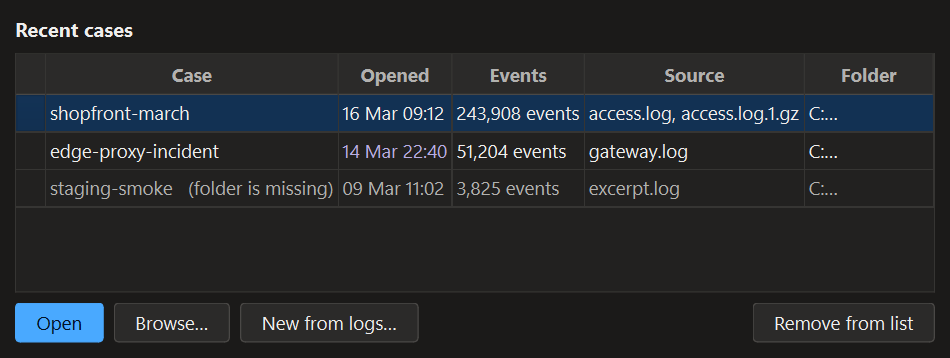

Opening the window offers the cases you have worked on before.
**Case → Open recent…** brings that list back at any time, and the
*Reopen the last case on start* preference skips it and goes straight to the one
you were in. **Browse…** opens a case folder that is not on the list, and
**New from logs…** makes a case. Once a case is open, the window's title names
it.

Ctrl-click chooses several rows and **Remove from list** takes them off the list,
which stays open — so tidying a list of ten is one pass rather than ten openings.
Right-click a row for **Pin to top**, **Rename…**, **Show in folder** and
**Remove from list**. A rename is a label here only: `case.json` keeps the case
id that every exported report prints.

**That list is kept on the machine you are working at.** It records which cases
were opened here — their folders, when, and how much was in them — under
`HKCU\Software\logarc` on Windows, beside the view preferences. That is a record
of what was investigated, not merely of how the window looked, so it has to be
removable: **Ctrl+A** then **Remove from list** takes every entry, and an emptied
list removes the registry key rather than storing an empty one in it.

---

## Reading a case

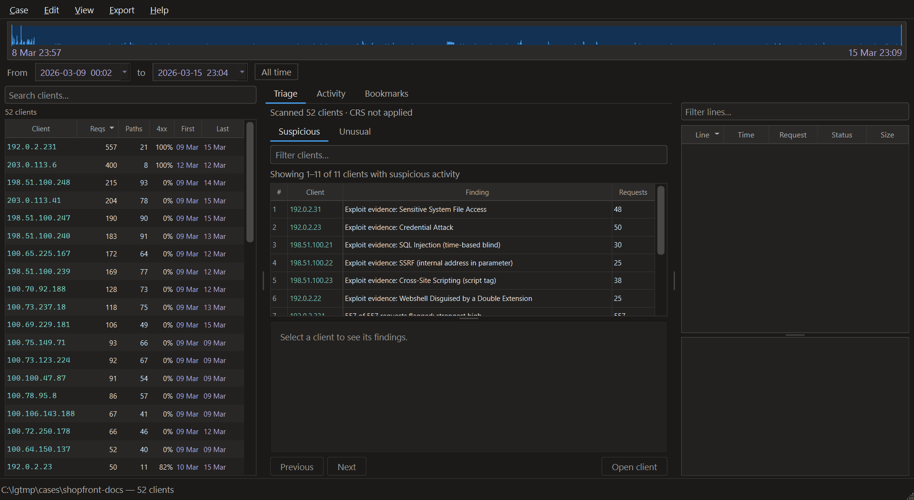

A case opens on **Triage**, which scans every client in the background and
queues the ones worth reading first, under **Suspicious** and **Unusual**.
Hover a queue's tab to see what puts a client on it;
[ip-prioritization.md](ip-prioritization.md) explains how each is ordered.
**Open client** opens the selected one in **Activity**.

The table on the left lists the busiest clients in the case, sortable by every column. The
`4xx` share is the one worth sorting by first: a client probing for things that
are not there looks exactly like a high refusal rate.

Pick a client and the reconstruction runs on a worker thread. Long work can be
cancelled. **Reading logs** into a new case says how far it has got: the file,
how much of it has been read, the lines so far, the speed, and the time left.
Reading a gigabyte takes minutes, and a busy tool is otherwise
indistinguishable from a hung one. The time left is withheld until the read has
settled and always reads *about*: the first seconds are the least
representative, and a confident figure drawn from them is the kind of number
this tool is built not to print. **Cancelling leaves the case unfinished**, so a
partial read can never be analysed as if it were complete.

**Pressing the client you are on lets go of it.** The graph goes back to waiting
and the band goes back to the whole case. Pressing a different row moves to that
client as it always did.

### Searching the case

The **Search clients** box above the list searches every client in the case, not
only the ones the table holds. Hover it for the filters it takes. An address
finds a client as it always did: part of one finds every client whose address
contains it, a whole one only that client, and several find any of them.

It also takes the evidence box's filters, and finds the clients that sent a
matching request:

| Filter | Finds |
|---|---|
| `status:404`, `path:/admin`, `method:POST`, any text | clients with at least one matching request, most matches first, with a **Match** column saying how many |
| `ip:10.0` | clients whose address contains it |
| `activity:enumeration` | clients the Triage scan saw that activity on, by category or by part of a rule's name. Quote a value with a space in it: `activity:"path traversal"` |
| `after:02:58`, `before:2026-03-09T03:00` | move the range above the list, and leave the box. A time of day is read on the range's first day |

The line above the list gives both numbers:
`8 of 52 clients sent a request matching path:/admin · 123 requests`. While a search
runs, no rows are shown, so nothing on screen can be read as its answer.

A time moves the range once it is a chip: after a space, after Enter, or chosen
from the list. So a pause while typing `after:2026-03-09` on the way to a time
on that day does not move the range to midnight. Whatever else is in the box is
searched again over the new range.

`activity:` is answered by the Triage scan. Until the scan finishes the
line above the list says so, and the list fills in by itself when it does.

Click the box to see what it searches by. Type `status:`, `method:` or
`activity:` to see the values in the range, with how many clients, and for a
status or a method how many requests, carry each.

**A client opened from a search of its requests is read the same way.** Its
evidence is filtered by those filters, and the first activity holding a match
opens. Addresses, activities and times chose the client and the range, so they
are not carried over.

---

## The two views

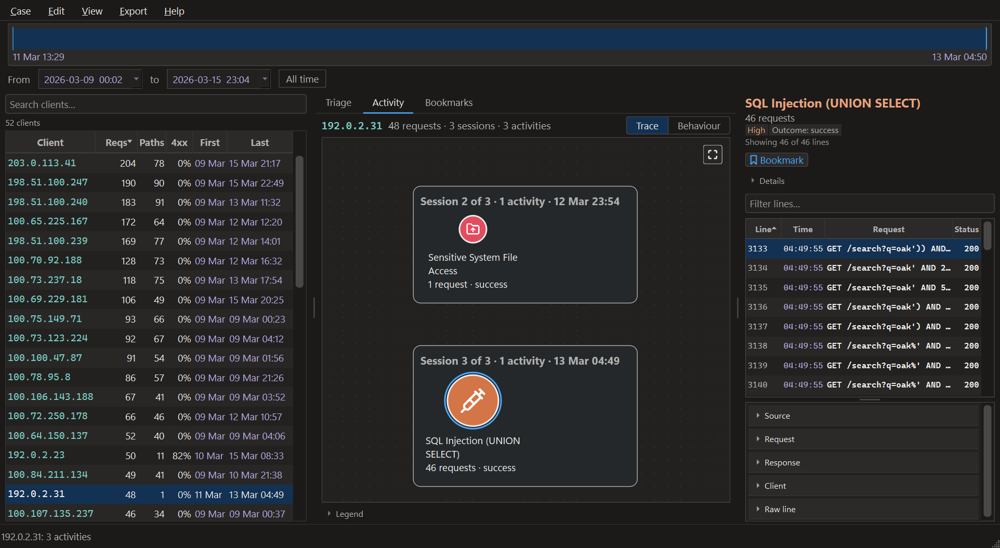

The **Activity** tab draws the open client two ways. Switch between them with
**Trace** and **Behaviour** beside the client's name, or from the **View** menu.

**Trace** is chronological: one node per episode, arrows in time order. It reads
as a sequence.

Long chains wrap onto further rows, alternating direction, because a trace drawn
on one line is as wide as it is long and shrinks to an unreadable smudge when
fitted to the window. The *Wrap long traces* preference turns the fold off when
the straight timeline is worth more than legible captions; the graph is then
panned rather than fitted, opening on its first activity.

Each session sits in a box of its own, headed by a name: the name of its most
important activity, picked the way an activity picks its own name. The most
severe comes first, then an attack over ordinary use, then the one with the
most requests. Under the name is its number, how many activities it holds and
when it ran, such as `Session 2 of 69 · 2 activities · 09 Mar 01:55–02:26`.
That gives the session count in the header something on the canvas to point
to. Rest the pointer on the heading to see what makes a session: no pause
inside it longer than 30 minutes, the same user agent throughout, and 8 hours
at most.

To give a session a name of your own, right-click anywhere inside its box and
choose **Rename session…**, or double-click its heading. **Use logarc's name**
in that window puts logarc's name back. A name you gave carries a pencil, and
the heading's tip begins with logarc's own name, so nobody takes your words for
something the log says. Names are kept in `session-names.json` in the case
folder, beside your bookmarks and outside the manifest, so they come back when
the case is opened again, on any machine the folder is copied to. A name
belongs to the session that holds the log line it was given at, the first line
of that session as it stood: a time filter that cuts that line off shows
logarc's name until the filter is cleared, and a name given while a filter was
on stays with the whole visit once it is cleared.

A box follows its activities when they are dragged. The *Outline each session*
preference turns the boxes off, and nothing moves when it does.

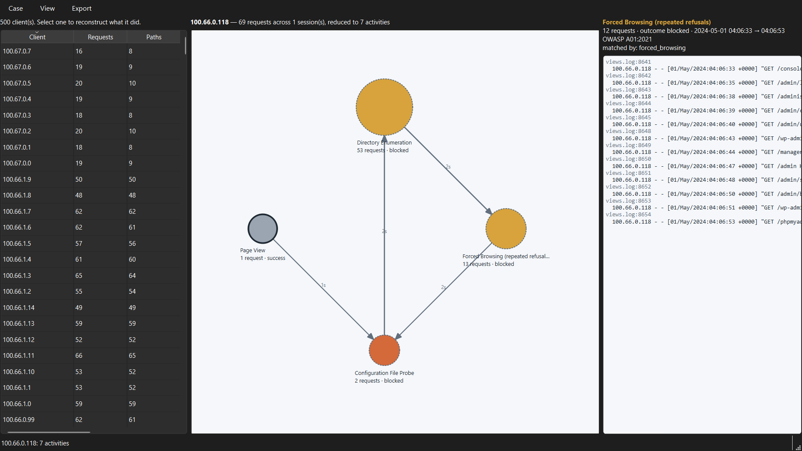

**Behaviour** is aggregated: one node per activity type, arrows weighted by
how often that transition was observed. It reads as a habit. The `x45` on an
arrow is the thing the trace cannot show — that the client went from one probe
to the other forty-five times.

Neither view links across a session boundary. A gap long enough to end a session
is a break in the story, not a transition within it.

### Icons

Inside every circle is an icon for the kind of activity it is: a syringe for
injection, a radar dish for reconnaissance, a key for a credential attack, a
globe for ordinary browsing. A graph reads at a glance before its captions do.
The circle's colour still says how serious the activity was and its outline
whether it worked; the icon says only what kind of thing it was, and the
caption stays the source of truth. Rest the pointer on a circle and the first
lines name the activity and its kind.

There are fourteen kinds, every rule names one of them, and each has its icon,
so no activity is drawn without one. The icons are
[Lucide](https://lucide.dev)'s, all 1,533 of them shipped with logarc.

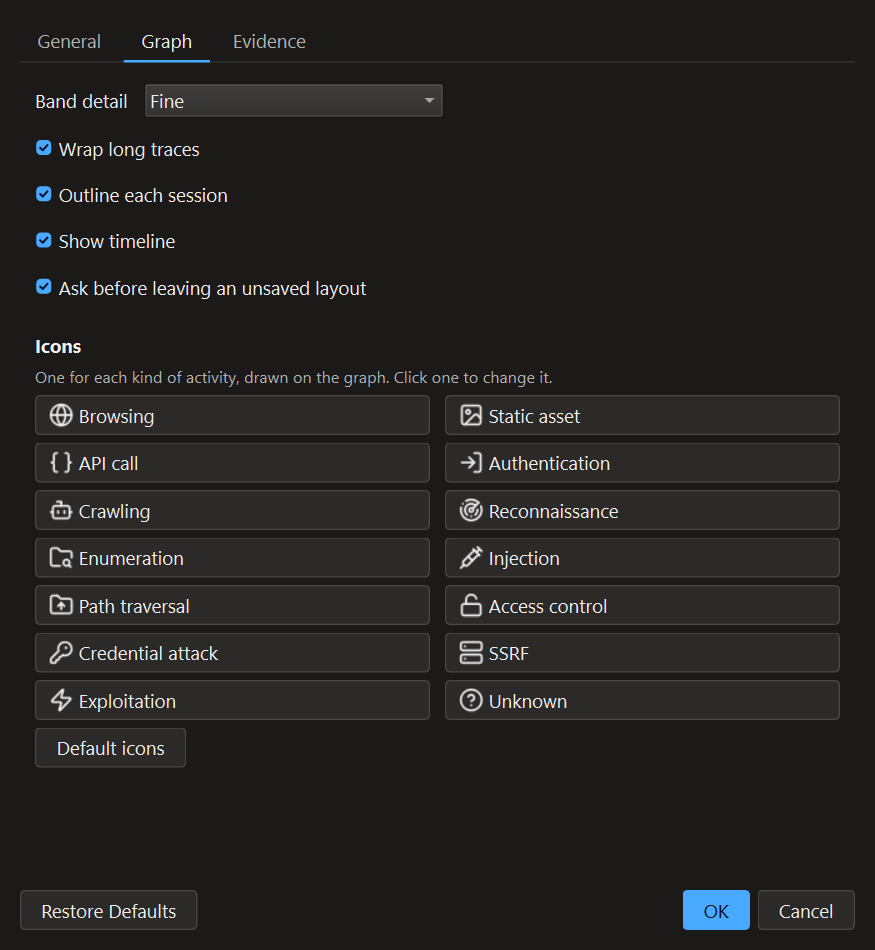

To change the icon of a whole kind, open **Edit → Preferences… → Graph** and,
under **Icons**, click the kind. Pick another from the gallery, searching it by
name or by what it shows (`lock`, `needle`, `cart`), or choose **From file…**
for an SVG or PNG image of your own, up to 1 MB. Your image keeps its own
colours, and it is copied into an `icons` folder beside your rules when you
press OK, so moving the original later changes nothing. **Default** in the
picker goes back to the kind's own icon; **Default icons** puts every kind
back. A rule of your own can have an icon of its own too, chosen in
[Add a rule](#adding-a-rule-without-yaml) or written as `icon:` in its YAML
([Writing rules](writing-rules.md)): it is drawn for every activity that rule
names, in place of its kind's.

**View → Full screen** gives the graph the whole window.

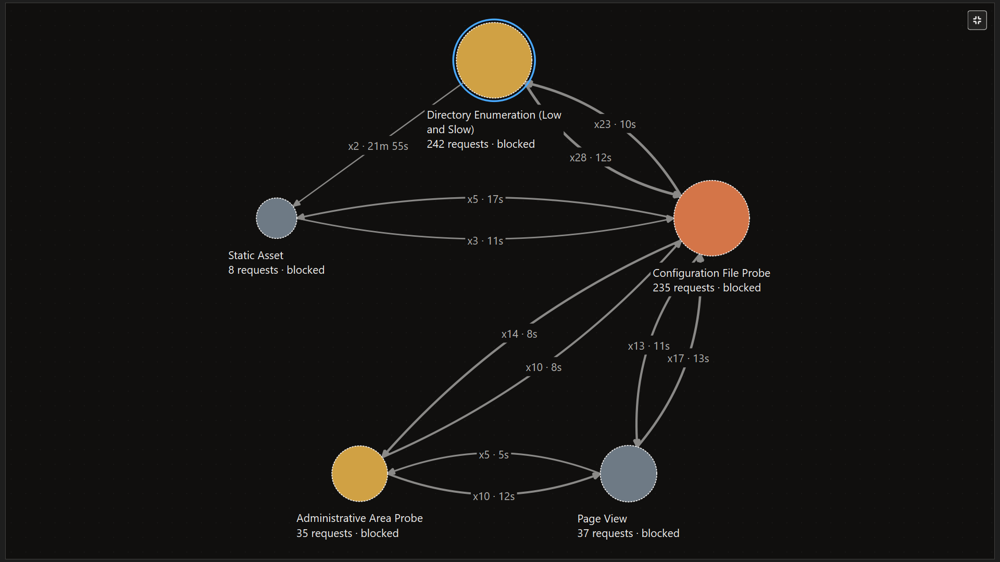

---

## The evidence

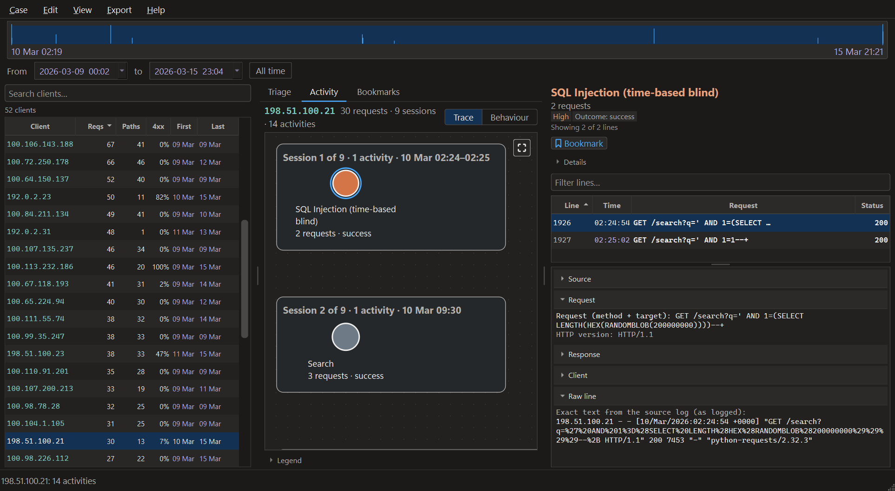

The panel on the right is what the selected node was built from, a row per
request, with the activity's time range, matching rules and OWASP mapping under
**Details** above it. Sort it by size to find the one that got data out, or by
status to find what was served rather than refused.

Payloads are decoded, so `' OR '1'='1` reads as the tautology it is instead of
`%27+OR+%271%27%3D%271`. The pane beneath holds the selected request in full,
and its **Raw line** is the source line exactly as the log holds it — every
finding traces back to a line.

### Repeated lines

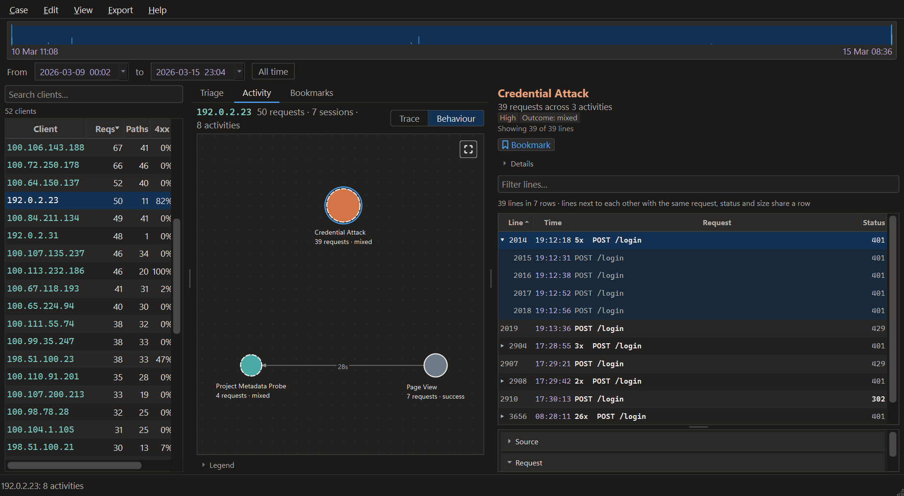

Lines next to each other that repeat are folded into one row with a count:
`5x  POST /login` is five attempts in a row, each answered 401 with the same
number of bytes. Double-click the row, press Enter or →, or click its arrow to see
each line with its own number and time; ← closes it again. By default a row folds
only lines with the same request, status and size, so it never shows a value one
of its lines did not have, and never lines from two separate visits. *Fold
repeated lines* in **Edit → Preferences…** offers looser rules, which fold more
and mark the values that differ as *mixed*, and Off. Sorting by anything but Line
shows every line on its own row.

Folding changes what the table draws and nothing else. The line count above it,
the filter, bookmarks and every export still deal in single lines.

### Filtering the lines

The **Filter lines** box above the table keeps the lines of the selected
activity that match what you type. A word keeps the lines whose request, path
and query, holds it, as logged or decoded. A filter narrows by one field:

| Filter | Keeps |
|---|---|
| `status:404` | that response code; `status:4xx` keeps the whole class |
| `path:/admin` | paths containing it; quote a value with a space, `path:"/my files"` |
| `method:POST` | that method |
| `after:02:58`, `before:2026-03-09T03:00` | requests at or after, or before, that time. A time of day is read on the activity's own day |

Two of the same filter keep either one. Different filters and words must all
hold. A finished filter becomes a chip, and Backspace or its × takes it off.
Anything the box cannot read as a filter is searched as text, so a typo narrows
the table rather than being quietly ignored.

Click the box to see what it filters by. Type `status:` or `method:` to see the
values this activity holds, with how many lines carry each.

The filter searches every line of the activity, not only the 2,000 the table
loads, and the line above the table says what it did:
`Filtered · 31 of 106 lines match status:304`. When nothing matches, the table
says *No results found* and offers to clear the filter.

The canvas fades every activity with no matching line, so the box also answers
"which of these had a 500?" before you pick one. The filter stays while you
move between activities and between the two views. Opening another client
starts without one, unless a search of the case found it by its requests: see
*Searching the case* above.

---

## Bookmarks

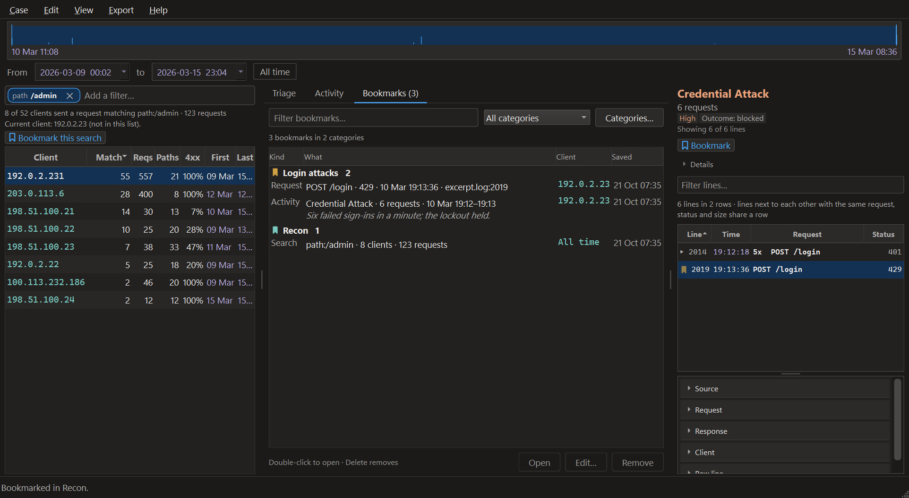

Anything worth coming back to can be saved, into a category, with a note:

| What | How |
|---|---|
| A client | Right-click it in the client list, in Triage, or in Who else |
| An activity | **Bookmark** under its heading in the evidence panel, or right-click it on the canvas |
| A log line | Right-click it in the evidence table |
| A search of the case | **Bookmark this search**, under the client box's answer |

**Ctrl+D** (**Edit → Bookmark…**) saves whatever has the keyboard: the selected
log line, the selected client in the list or the queue, or the client box's
search. Anywhere else it saves the activity being read, or else the client.

The box that opens says what is being saved and whose it is. **Category** starts
at the last one used; type a new name to make a new category. The note is
optional. Enter saves and Esc cancels. Saving something already bookmarked opens
that bookmark to edit, rather than making a second one.

A bookmarked client, activity or log line wears a ribbon in its category's
colour: beside the address in the client list, on the activity in the graph, and
on the line in the evidence. Hover over it to read which bookmark it is.

The **Bookmarks** tab lists them by category, newest first, and its name counts
them. The box above keeps the bookmarks that hold every word you type, in the
description, the note, the client or the category. **Categories…** renames and
deletes them. Deleting a category moves its bookmarks to the first one, which
can be renamed but not deleted.

Double-click a bookmark, or press Enter or **Open**, to go back to it:

- a client or an activity opens in its graph, the activity selected and in view;
- a log line opens selected in the evidence, in its activity. An evidence
  filter that leaves it out stays on, and the panel says nothing matches;
- a search runs again over the range it was made in.

If the range in force leaves the bookmark out, the range becomes **All time**
and the status line says so; the fields above the panels narrow it again. A
bookmark whose client or log file is no longer in the case says *Not found in
this case any more.* It can still be edited and removed, but not opened.

**Bookmarks are kept with the case**, in `bookmarks.json` in its folder, so a
case copied to a colleague takes them along. Two windows can have the same case
open: each keeps what the other saved, and shows it when you come back to it. A
file that cannot be read is left as it is, and the tab says so; the next change
saved moves it aside as `bookmarks.unreadable.json`.

The HTML report lists the exported client's bookmarks, with their notes and,
for a log line, the line itself. **Export → Bookmarks (CSV)…** writes every
bookmark in the case to a CSV file: category, kind, client, what, note, when
saved, and for a log line or an activity its file and line number and the line
itself.

---

## Moving things about

Activities can be dragged where you want them. Their arrows and the selection
ring come along, **Ctrl+Z** takes the last move back, and **Edit → Save
layout** keeps it for the next time this client is opened.
**Edit → Reset layout** returns to the computed one and forgets what was saved.

The panels keep the sizes you drag them to — the client list, the graph and the
evidence beside each other, the evidence table over its details, and the queue
over its reasons in **Where to start** — and the window keeps its size and
place, from one start to the next. A window closed in full screen opens as it
was before full screen. **View → Reset panel sizes** puts the panels back to
the sizes logarc opens with, after asking; Cancel is the default, and the
window keeps its own size.

**A saved layout is a record of what you were reading.** It is filed under
the case, the client, the view and the wrap setting, and the coordinates it holds
are keyed by activity id — which for a trace carries the client's address in
plain text. So saving a layout writes down which client of which case you
were reading, in the same place and with the same consequences as the recent-case
list. **Reset layout** removes the one for the graph in front of you.

---

## A stretch of time

The band above the panels shows where the traffic sits — the day-night rhythm,
and the bursts standing out of it — and a stretch is dragged out of it or typed
into the **From** and **to** fields beside it.

Both halves of the window narrow together: the client list shows only who was
active in that stretch, with that stretch's own counts, and the graph is
*reconstructed* from those requests rather than drawn with parts hidden. An
activity that straddles the edge reports what is inside it, not what it would
have been over the whole case.

Because that is a different answer, it is given a different name: identifiers
carry the range, so `100.67.0.86@20240502T012500-20240502T020000#1/1` can never
be mistaken for the whole-case `100.67.0.86#1/1` in a folder holding both
reports. Without a range nothing changes — every case and report made before this
existed still reads exactly as it did. **All time** goes back.

**The band follows whoever is being read.** Before a client is picked it draws the
whole case. Pick one and it becomes that client's own history, across that
client's own life — first request to last — so a client alive for ninety minutes
fills the band instead of being a hairline in the middle of two days. Letting go
of the client hands the case back.

The band is optional: the *Show timeline* preference, or **View → Timeline**,
turns the drawing off and gives its pixels back to the graph. Only the picture
goes — the fields and **All time** stay, because they are the precise control
and the one to fall
back on for a stretch too narrow to drag onto.

---

## Log formats

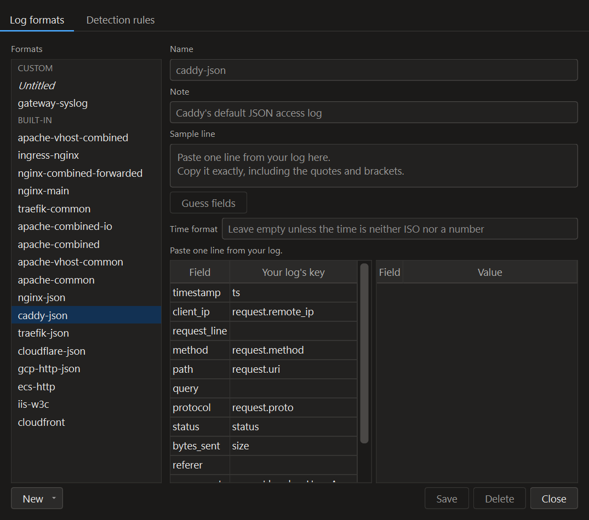

The *Log formats* tab of **Case → Formats and rules…** lists yours under
**CUSTOM** and the ones that ship under **BUILT-IN**, and neither can be
confused for the other: a built-in is readable and not editable,
because registration order is preference order and an edited copy of
`apache-combined` would never be reached.

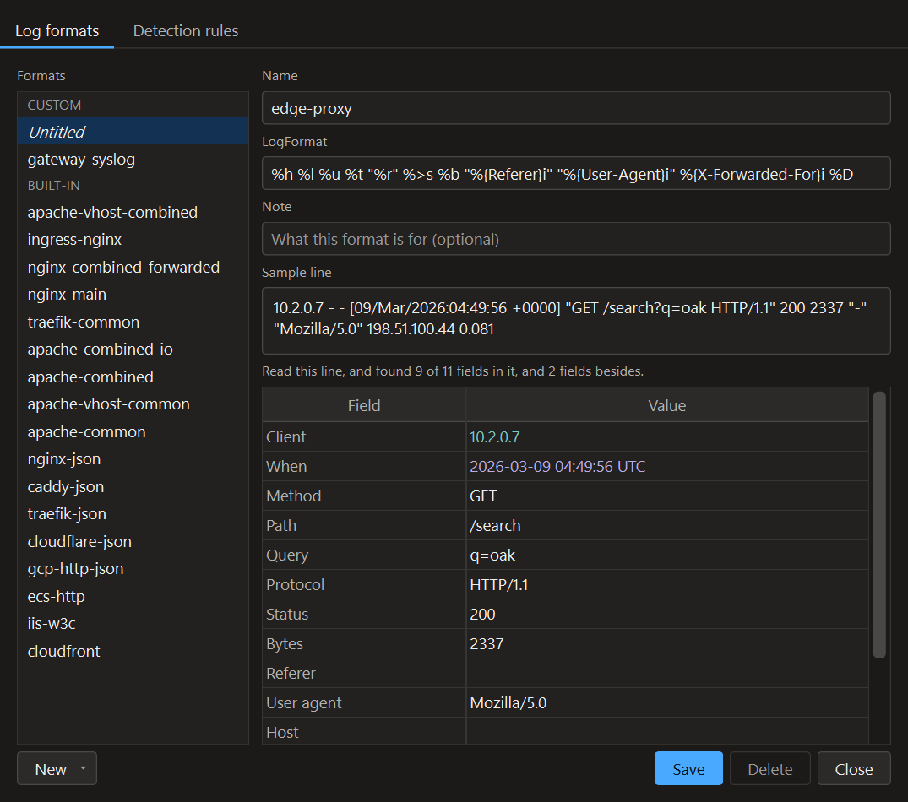

Paste one line from your log into **Sample line** and the rule is tried against
it as you type. Here a
directive with a forwarded-for header and a duration reads into nine of the
eleven canonical fields plus two more besides — and those two are usually the
whole reason a site has a format of its own. A rule that reads nothing says so.

**New**, under the list, offers the same four kinds the CLI does: **Text
(LogFormat)** for a text log, **JSON** for a field mapping, **Table (CSV, TSV,
W3C)** for columns, and **Pattern (regular expression)** for anything else. For
a JSON log or a table, **Guess fields** fills the mapping from the sample line.

---

## Detection rules

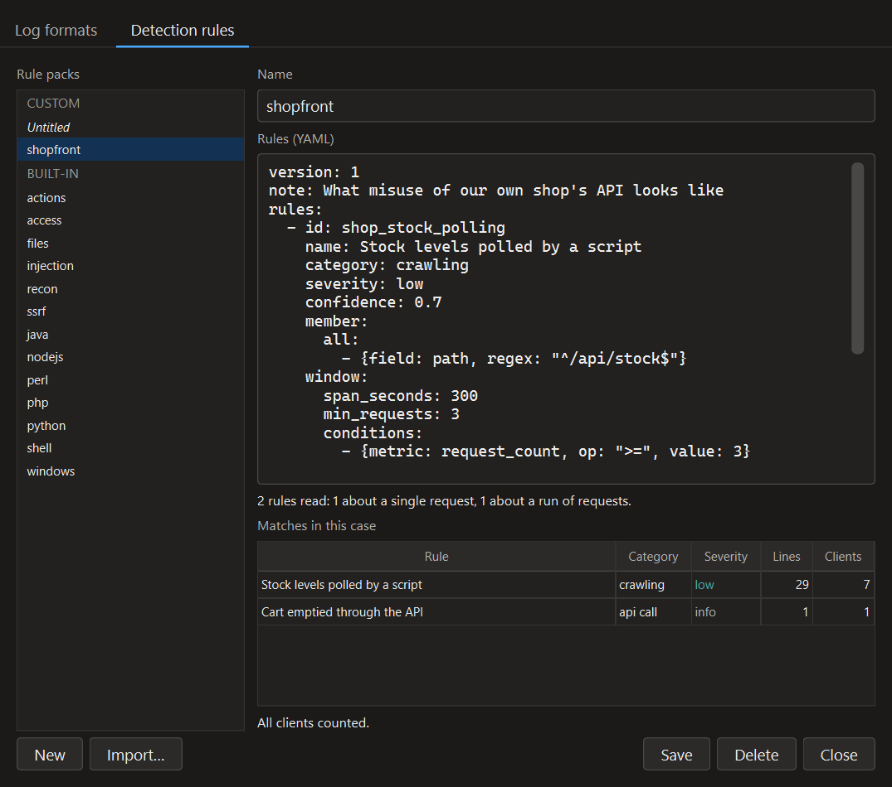

The second tab of **Case → Formats and rules…** holds the rules that say what a
line *means*. The first tab decides whether a line can be read at all. On the
left are yours, under **CUSTOM**, and then the 13 packs that ship with logarc,
under **BUILT-IN**, named by file (actions, access, files, injection, recon,
ssrf, java, nodejs, perl, php, python, shell, windows).

**Your packs** are YAML, in the format [writing-rules.md](writing-rules.md)
describes. They live in your settings, beside your saved formats
(`%APPDATA%\logarc\rules\`, one `<name>.yaml` each, or under `LOGARC_HOME` when
that is set), so every case you open is read with them. **New**, under the
list, starts from an empty pack with a commented example. **Import…** copies a
pack in under its file name: `My Rules.yaml` becomes `My-Rules`. A name holds
letters, digits, `-` and `_`, and two of your packs cannot share one, whatever
their capitals.

About half a second after you stop typing, the pack is read. The line under the
editor says how many rules it holds, and of which kind, or what is wrong. A
mistake is scrolled into sight and marked: the line itself for a YAML mistake,
and for a rule mistake the condition it names, or failing that the rule's `id:`
line. Save stays off while the pack has a mistake, and the version you last
saved keeps applying. A rule may not reuse the id of a built-in rule that is
switched on, or of a rule in another of your packs.

*Matches in this case* counts, for each rule, the lines it
labels and the clients they come from. It counts every label a rule puts on a
line, not only the one that names it, so a rule that fires and is outranked
still shows. The counts fill in as clients are read and start again when you
edit. They are the lines a reconstruction would credit: rules about a run of
requests are counted session by session, as the graph labels them. On the
`2026-10-06-medium` [evaluation build](evaluation.md) (235,732 requests from
2,760 clients) a pack of two rules took about 6 seconds, and the 24-rule
injection pack 64 seconds.

**A built-in pack** shows as a table of its rules, with what each finds. **View
YAML** shows its source, which you cannot edit. Untick a rule that is wrong for
your site and it is switched off for every case. It stays in the table, ready to
be ticked again. Switching a built-in rule off frees its id, so a rule of yours
can replace it.

### Adding a rule without YAML

**Add rule…**, under the list beside **New** and **Import…**, opens a window
that writes one rule for you: a rule about a single request, the kind
[writing-rules.md](writing-rules.md) calls a signature rule. Rules about a run
of requests or a sequence of them are written in YAML.

Give the rule a name, say what kind of activity it is and how severe, and add
conditions: a field, a test and a value, such as *Path (decoded)* *matches
pattern* `^/uploads/.+\.php$`. A request matches when all of the conditions are
true, or any of them, as you choose. The decoded fields are listed first and
are usually the ones to use; *as logged* fields test what was literally sent.
Upper and lower case match alike in every test. Confidence, an OWASP category
and references are under **More**, and left empty they are not written.
**Icon** shows what the graph will draw for an activity the rule names, the
kind's icon until you choose another with **Change…**; an image of your own is
copied into your icons folder when the rule is added.

About half a second after you stop typing, the rule is checked and the window
says what is missing or wrong, the id the rule will be saved with, and what it
matches in the open case: matches and clients, and a few example lines by line
number. **View YAML** shows the rule as it will be written. **Add rule** stays
off until the rule can be added; you need not wait for the count to finish.

The rule goes into the pack chosen under **Save into**: the one selected in the
tab, or **My-rules**, created the first time. It is added at the end of that
pack and nothing else in the pack changes, comments included. If the pack was
changed in another program while the window was open, or is laid out in a way
the window cannot add to, nothing is written and the window says so; **View
YAML** gives you the text to paste in the YAML editor instead. If the page in
the tab has changes you have not saved, the tab asks whether to save them before
the window opens.

**From the evidence panel**, right-click a line nothing caught and choose
**Make a rule from this line…**. The window opens on that line's parts, each
with a tick box; the path and the query are ticked. **Continue** turns the
ticked parts into conditions that match only those exact values, so widen one
with *matches pattern* if the rule should catch more than this request. If the
log file changed since it was read in, the window repeats the evidence panel's
warning: the case may then not hold the line you see.

A pattern that takes very long to match on a long value, such as `(a+)+$`, can
keep the count running; the window stays usable. The same pattern in a pack
slows the YAML editor's counts and the reading of a case in the same way.

**When you change rules with a case open**, the tab asks first: *Saved. The open
case was read with the old rules.* **Re-read now** reads the open client again
and starts *Triage* over with the new rules. **Later**, or closing the dialog,
leaves a strip in the window, *Rules changed since this case was read.*, with a
**Re-read** button. A rule added with **Add rule…** or **Make a rule from this
line…** is asked about the same way, in its own window. The scan made with the rules before is kept,
and switching back to them reuses it.

A pack that does not load, because it was edited by hand or written by a later
version, is listed under **CUSTOM** as *(does not load)*, with the reason as its
tooltip.
It is left out and never rewritten, and a strip in the window names it whenever
a case is read without it.

The HTML report says which rules it was read with, under Provenance: how many
built in, which were switched off, and each of your packs by name. The command
line does not read your packs; its `--rules` takes pack files explicitly
([ADR-0013](adr/0013-rules-a-reader-writes.md)).

---

## When a case is incomplete

A case that could not read all of its logs says so, every time it is opened — an
amber strip naming how many lines were refused and what share of the file that
was. When a whole log produced *no* events, that is not damage but the wrong
parser, so it interrupts instead, naming the file and the format it was read as;
that name is the part that separates a wrong parser from a log that genuinely
holds nothing.

**Show refused lines** on the strip lists them. The counts come from the case
manifest rather than from having watched the read, so they are still there when
a colleague opens the case a week later. Nothing is shown when nothing was
refused — silence means the case holds everything its logs did.

A case whose format has been edited or deleted since the case was made says
that too. The case itself is unaffected: it records the format *definition* it was
read with, not the name.

---

## How it is checked

The window is verified by hand against
[manual-test-plan.md](manual-test-plan.md) — whether the node you clicked is the
one whose evidence appeared is a judgement about what a person sees.

The decisions that determine whether a graph *misinforms* are kept out of Qt, in
`logarc.style`, and tested directly. A finding is the same colour in the window
and in the exported report because both read the same table.
