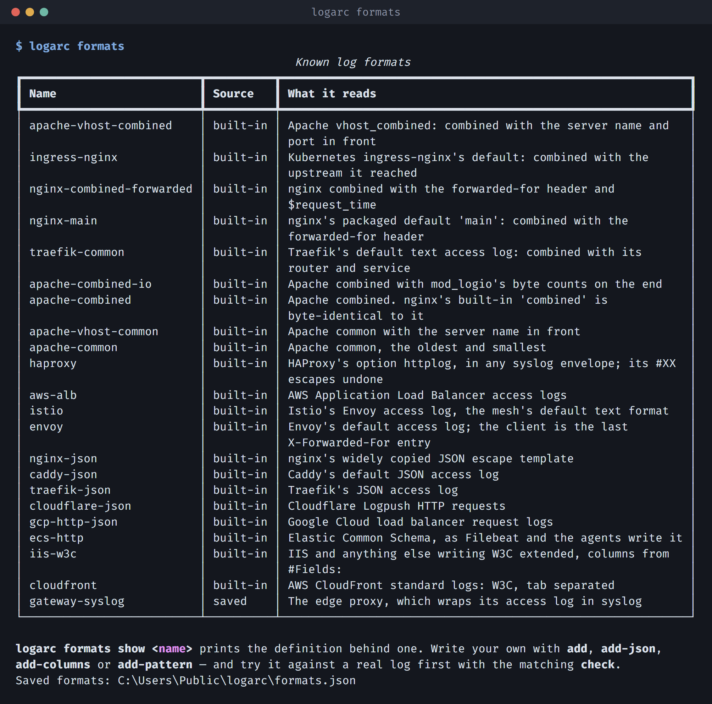

# Log formats

In the window, **Case → Formats and rules…** shows the whole library, and a format
written there is tried against your log as you type. The command line does the
same, as below.


The format is detected from the first lines of a log. When it cannot be, ingest
**refuses rather than guessing** — the wrong parser quarantines every line and
presents as an empty result, which is the worst failure this tool has.

## What is read without naming a format

| Format | What writes it |
|---|---|
| `apache-combined` | Apache's `combined`, and the servers that write the same line: the nginx that Debian and Ubuntu package, OpenLiteSpeed, Express's morgan `combined`, Traefik's `genericCLF` |
| `apache-combined-io` | Apache `combined` with mod_logio's byte counts on the end |
| `apache-common` | Apache `common` |
| `apache-vhost-combined` | Apache `vhost_combined`: the server name and port in front |
| `apache-vhost-common` | Apache `common` with the server name in front |
| `nginx-main` | nginx from nginx.org's own packages and the official Docker image: `combined` plus the forwarded-for header |
| `nginx-combined-forwarded` | nginx `combined` plus the forwarded-for header and `$request_time` |
| `ingress-nginx` | Kubernetes ingress-nginx, its default `upstreaminfo` |
| `traefik-common` | Traefik's default text access log |
| `traefik-json` | Traefik with `format: json` |
| `nginx-json` | The JSON escape template nginx sites copy |
| `caddy-json` | Caddy's default access log |
| `cloudflare-json` | Cloudflare Logpush, HTTP requests |
| `gcp-http-json` | Google Cloud load balancer request logs |
| `ecs-http` | Elastic Common Schema, as Filebeat and the Elastic agents write it |
| `iis-w3c` | IIS, and anything else writing W3C extended |
| `cloudfront` | AWS CloudFront standard logs |

Each one is tested against a line in the shape its server writes. For
`nginx-main`, `ingress-nginx` and `traefik-common`, those lines were captured
from the servers themselves. ingress-nginx's came from nginx running its exact
log format.

Four things are worth knowing about logs from containers and proxies:

- **Traefik keeps no request headers by default.** Its log writes `-` for the
  Referer and the User-Agent even when the request sent both, so the rules that
  read the User-Agent have nothing to read. Start Traefik with
  `--accesslog.fields.headers.names.User-Agent=keep` and
  `--accesslog.fields.headers.names.Referer=keep` to record them.
- **`docker logs` and `kubectl logs` mix in the server's own messages.** Start-up
  and error lines are not requests. They are set aside and counted, and never
  read as one. Detection needs 60% of the first 200 lines to be requests, so a
  log that is mostly messages is not recognised on its own. Measured: 200
  requests to the nginx image, half of them 404s, came to 59% once its error
  log was merged in. Name the format then: `--format nginx-main`.
  `docker logs nginx > access.log` keeps only the start-up lines and the
  requests, and is recognised.
- **Behind a load balancer, the client may be the load balancer.** These formats
  take the client from `$remote_addr`. ingress-nginx sets that to the real
  client only when it is told to trust what is in front of it
  (`use-forwarded-headers`, `enable-real-ip` or the PROXY protocol). A forwarded-for header is
  kept beside the event and never used as the client: anyone can write one.
- **Apache combined with `%D` on the end is no server's default.** It is a site's
  own setting, so it is a format to add once:
  `logarc formats add apache-timed '%h %l %u %t "%r" %>s %b "%{Referer}i" "%{User-Agent}i" %D'`.

```bash
logarc formats                     # every format, built in and saved
```



A format you write yourself is a first-class one: saved by name, offered wherever
the built-ins are, usable in every later case. There are four kinds, and none of
them needs Python.

```bash
# A text log: write the Apache LogFormat directive down.
logarc formats check '%h|%t|"%r"|%>s|%b' --log access.log
logarc formats add office-edge '%h|%t|"%r"|%>s|%b'

# Or paste nginx's log_format, as it is in nginx.conf or just the format.
logarc formats add site-timed '$remote_addr - $remote_user [$time_local] "$request" $status $body_bytes_sent "$http_referer" "$http_user_agent" rt=$request_time uct="$upstream_connect_time" uht="$upstream_header_time" urt="$upstream_response_time"'

# One JSON object per line: the mapping is proposed for you, nested keys included.
logarc formats check-json --log gateway.jsonl
logarc formats add-json gateway --log gateway.jsonl --map client_ip=http_x_real_ip

# A table: IIS declares its columns in `#Fields:`, most CSVs in the first row.
logarc formats add-columns iis --log u_ex240501.log
logarc formats add-columns edge --log edge.csv --separator comma

# Anything else — syslog-wrapped, an appliance with a syntax of its own.
logarc formats add-pattern gw-proxy '^(?P<timestamp>\S+) (?P<client_ip>\S+) …' \
    --time-format '%Y %b %d %H:%M:%S'
```

In a directive, a field in quotes or in brackets reads up to the closing quote
or bracket, spaces included, and may be empty. An unquoted header or variable
(`%{X-Forwarded-For}i`, `%{upstream_addr}e`) may be a list, `a, b` or `a : b`.
If it ends the line, it reads to the end of it. None of this narrows a field:
a line the plain reading accepts is read exactly as before.

In a JSON, table or pattern format, a field mapped to `path` that also holds the
query (`/search?q=oak`) is split at the `?`, the way a request line is. A field
mapped to `url` is a whole URL, such as Google's `requestUrl`, and is read as its
host, path and query. A client written with a port it cannot be confused with,
`203.0.113.5:51234` or `[2001:db8::1]:443`, is read as the address alone, and the
port is kept beside the event. A bare IPv6 address is left as written, since
`2001:db8::1:443` could end in a port or in its own last group.

An nginx `log_format` can be pasted wherever a directive can: the whole
statement from `nginx.conf` (`log_format main '...' '...';`, comments and line
breaks included), its quoted strings, or the format alone. It is kept as you
wrote it and read as the directive it means. The common variables have one:
`$remote_addr` is the client, `[$time_local]` and `$time_iso8601` the time,
`$request` the request, `$http_user_agent` and every other `$http_…` a header,
`$request_uri` the path and the query. Any other variable, such as
`$upstream_response_time`, is kept beside the event. Three formats are refused,
each saying why:

- One that writes JSON (`escape=json`): read its log as a JSON format instead,
  with `logarc formats add-json NAME --log FILE`, which proposes the mapping from
  the log itself.
- One with no `$time_local` or `$time_iso8601`. `$msec` is not read yet.
- One with no `$remote_addr`. A forwarded-for header is the client's own to write,
  and is not read as the client.

A time format naming no year is **refused** rather than accepted: `strptime`
supplies 1900 for a missing year, and a case where every event is dated 1900 is
exactly the kind of number this tool exists not to emit.

**A format is a definition, not a name.** Each case records the definition it was
ingested with, so editing or deleting a saved format later cannot make an
existing case unreadable. See
[ADR-0010](adr/0010-a-log-format-is-data-that-travels-with-the-work.md).

Deliberately absent: AWS ALB, Envoy and HAProxy, which write the client as
`address:port`. Stripping the port is not safe without deciding what to do about
IPv6, where the colons are part of the address, and a wrong answer turns every
connection from one client into a client of its own. All three are readable today
with a pattern of your own.
